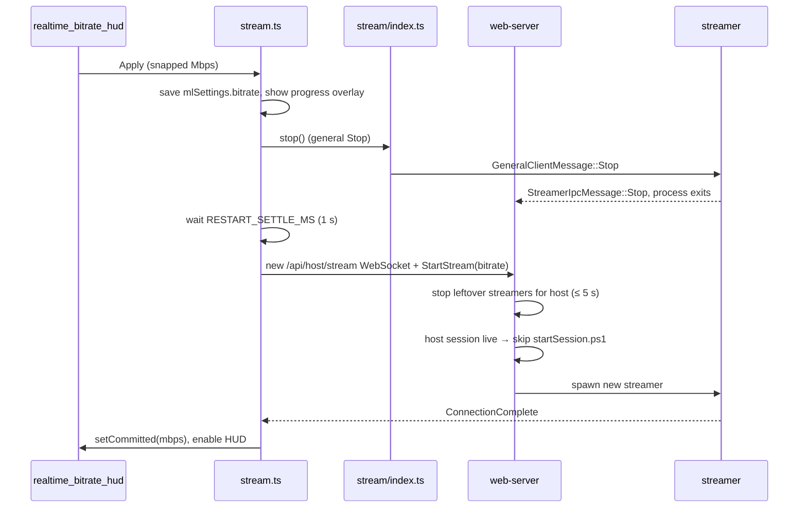

# Bitrate HUD — architecture and flow

This document describes the on-stream **bitrate** control: what it does, how data moves through the stack, and which files participate.

For the full session-level flow (restart sequence, host-session guard, CleanSession interaction), see [realtime-bitrate-flow.md](./realtime-bitrate-flow.md).

## Purpose

The bitrate HUD lets the user pick a new **target video encode bitrate (Mbps)** while a session is active. The bitrate is **fixed for the lifetime of a stream** (same model as upstream moonlight-web / MrCreativ): pressing **Apply** restarts the stream in-page with a new `StartStream` carrying the new bitrate. There is no live encoder reconfigure, no Sunshine HTTP call and no adaptive bitrate in this client.

The **collapsed strip** is a single native `<input type="range">` layered over a tier bar. The **expanded panel** adds explanatory copy, a large readout, preset chips, and tier-specific hints. Moving the slider or picking a preset only changes the pending value; nothing is sent until **Apply**.

Numeric bounds and snapping are defined in `web/component/realtime_bitrate_hud.ts`; the slider range is profile-scoped (see `web/stream_profile_presets.ts`).

## Layered architecture

| Layer | File(s) | Responsibility |
|--------|-----------|------------------|
| HUD component | `web/component/realtime_bitrate_hud.ts` | Builds DOM (strip, range, value edit, presets, close). Tracks the pending value and the committed (session) value in **Mbps**. |
| Stream UI glue | `web/stream.ts` | Creates the HUD inside `video-overlay-hud-tray`; **Apply** → `applyOverlayBitrate` → `restartStreamWithNewSettings`. Enables the HUD on `connectionComplete` / `generalChannelReady`. |
| Stream session | `web/stream/index.ts` | Sends `StartStream` with `bitrate` (kbps) on the signaling WebSocket. `getSessionBitrateMbps()` returns the bitrate the session was started with (stats "target" row). |
| Web server | `src/api/stream.rs`, `src/stream_sessions.rs` | Stops any previous streamer for the host before launching the new one; skips `startSession.ps1` while the host session is live. |

## End-to-end flow (user presses Apply)

If a restart or initial startup is already in progress, **Apply** is ignored (`restartInFlight` / `startupInProgress` guard).

## Messages

The HUD uses no dedicated messages. Bitrate only travels in `StreamClientMessage::StartStream { bitrate, .. }` (kbps). The WebRTC **general** channel carries `Stop`, `QueryKeyboardLocks`, `ConnectionStatusUpdate`, `HdrModeUpdate` and `KeyboardLocks`.

## Styling

`web/styles/moonlight.css` and `web/styles/standard.css`: `.ml-rt-bitrate*`.

## Quick file index

| File | Role |
|------|------|
| `web/component/realtime_bitrate_hud.ts` | HUD DOM, snapping, tiers, presets |
| `web/stream.ts` | Tray, HUD wiring, Apply → restart |
| `web/stream/index.ts` | `StartStream`, `stop()`, `getSessionBitrateMbps()` |
| `src/api/stream.rs` | Streamer launch, previous-streamer stop, prep guard |
| `src/stream_sessions.rs` | Per-host streamer registry and session liveness |
| `web/component/settings_menu.ts` | `bitrate`, `showStreamBitrateHud` |
